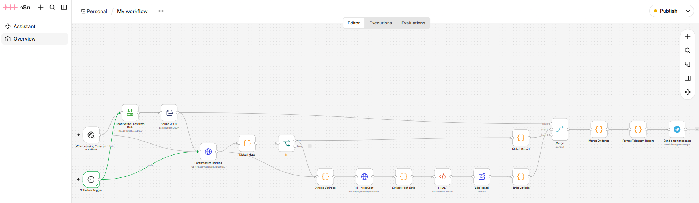
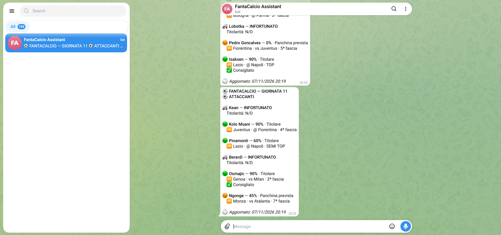
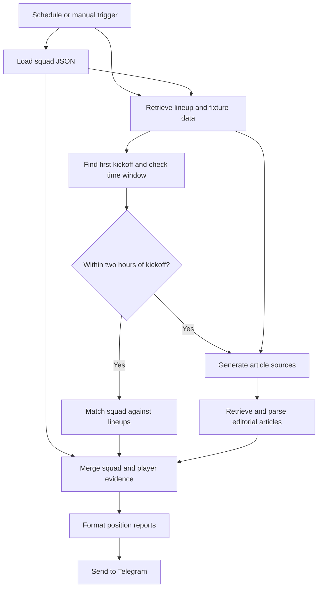

# Fantasy League Assistant

**A self-hosted Serie A fantasy football assistant built with n8n, JavaScript, Docker, and Telegram.**

Fantasy League Assistant collects projected lineups, player availability, and editorial recommendations, matches them against your fantasy squad, and sends position-specific Telegram reports. Scheduled execution and dynamic retrieval of the matchday's first kickoff help time reports around the start of each round.

The current implementation uses deterministic data processing to consolidate evidence for your lineup decisions.

## Features

- **Scheduled execution:** an n8n Schedule Trigger checks hourly from 12:00 through 21:00 in the workflow's configured timezone.
- **Dynamic matchday start:** fixture dates from the lineup API determine the earliest kickoff, without a manually entered matchday start date.
- **Kickoff window:** a Code node checks whether the first match starts within the next two hours, and an If node controls the squad-matching branch.
- **Lineup information:** projected starters, substitutes, starting probabilities, injuries, suspensions, opponents, and home/away fixtures.
- **Editorial recommendations:** top picks, players to avoid, surprises, positional tiers, and match-specific advice.
- **Squad matching:** name normalization handles accents, punctuation, capitalization, and some surname-initial variations.
- **Telegram delivery:** four HTML-formatted reports covering goalkeepers, defenders, midfielders, and forwards.
- **Reproducible deployment:** Docker Compose pins the n8n image and keeps persistent state separate from the workflow export.

## Demo

Reports show starting probability, projected lineup status, fixture, editorial flags, and positional tier. Injured players receive a prominent availability warning, with further recommendations omitted.

Illustrative report excerpt:

```text
FANTACALCIO — GIORNATA 11
PORTIERI

Caprile — 100% · Titolare
    Cagliari vs Frosinone · 5ª fascia

Perri — 100% · Titolare
    Torino vs Lecce · SEMI TOP
    Scommessa
```

This is a historical example, not current matchday advice.

### Workflow



### Telegram report



## How it works

The workflow loads a local squad file and retrieves Fantamaster lineup data. It derives the matchday number and first kickoff from that response, then combines lineup information with recommendations extracted from editorial articles.



The diagram reflects the current export: article retrieval also has a direct connection from the lineup request, so the kickoff check does not gate every branch. The workflow generates a matchday report key, but does not currently use it to suppress repeat reports. Multiple scheduled executions can qualify within the two-hour window.

### Data sources

| Source | Use |
|---|---|
| `https://publicapi.fantamaster.it/lineups/` | Matchday, fixtures, projected lineups, probabilities, and availability |
| `https://newsapi.fantamaster.it/wp-json/wp/v2/posts` | Editorial articles retrieved using matchday-based slugs |

The editorial parser extracts recommended players, players to avoid, surprise picks, and positional tiers using JavaScript in n8n Code nodes. No LLM is used in the current pipeline.

Each player's starting probability, medical availability, tier, and editorial flags remain separate. Source URLs are retained, and conflicting recommendations are preserved for human evaluation.

## Repository structure

```text
n8n_FantasyLeague_Assistant/
|-- README.md
|-- .gitignore
|-- .env.example
|-- docker-compose.yml
|-- published-workflows/
|   `-- My workflow.json       # Sanitized, importable n8n workflow
|-- scripts/
|   |-- anonymize_workflows.py # Generate public copies from private exports
|   `-- test_anonymize_workflows.py
|-- data/
|   `-- squad.json             # Tracked example roster, not n8n runtime data
|-- assets/
|   |-- workflow.png
|   `-- telegram-report.png
`-- docs/
    |-- deployment.md          # Deployment, migration and backup instructions
    `-- publishing.md          # Sanitizing exports and cleaning local Git history
```

For a fresh installation, setup creates these local paths, which Git ignores:

```text
.env                          # Machine-specific Compose settings
workflows/
    My workflow.json          # Private original n8n export
files/
    squad.json                # Your roster, mounted at /files/squad.json
n8n-data/                     # n8n database, credentials and encryption configuration
```

The default runtime directory is `n8n-data/`; the tracked `data/squad.json` is only the example roster. Storage paths can be overridden in `.env`. Private backups belong outside version control; `backups/` is also ignored.

## Getting started

### 1. Clone the repository

```bash
git clone https://github.com/choppadebug/n8n_FantasyLeague_Assistant.git
cd n8n_FantasyLeague_Assistant
```

You need Docker with Compose, a Telegram bot created through [@BotFather](https://t.me/BotFather), and network access to the data sources.

### 2. Configure your roster

For a fresh installation, run these commands in PowerShell from the repository directory:

```powershell
Copy-Item .env.example .env
New-Item -ItemType Directory -Force n8n-data, files
Copy-Item data/squad.json files/squad.json
```

Edit `files/squad.json` with your own players. The structure is:

```json
{
  "players": [
    { "name": "Caprile", "role": "GK" },
    { "name": "Calhanoglu", "role": "MID" },
    { "name": "Pinamonti", "role": "FWD" }
  ]
}
```

This shortened example shows the format only. The workflow expects 25 players; the supplied roster contains 3 goalkeepers, 8 defenders, 8 midfielders, and 6 forwards. Supported roles are `GK`, `DEF`, `MID`, and `FWD`.

### 3. Start n8n

```powershell
docker compose config --quiet
docker compose up -d
```

Open [n8n locally](http://localhost:5678) and create the owner account.

Compose pins the n8n 2.46.6 image by digest, binds port 5678 to localhost, sets the container timezone to Europe/Rome, persists n8n state in `n8n-data/`, and mounts `files/` read-only. The `.env.example` file documents optional storage-path and host-port overrides.

**Existing installation:** follow the [migration and backup instructions](docs/deployment.md) before starting Compose. A fresh instance does not automatically use your existing workflows or credentials. Never run two n8n instances against the same SQLite data directory.

### 4. Import the workflow and configure Telegram

1. In the n8n editor, import `published-workflows/My workflow.json` using **Import from File**.
2. Review the imported nodes and connections.
3. Create or select an n8n Telegram credential containing your bot token.
4. Start a conversation with your bot and set your own chat ID in the Telegram node. Replace any exported value.
5. Confirm that the message text is `{{ $json.message }}` and the parse mode is HTML.

The workflow export does not provision the local roster or transfer Telegram credential secrets. Configure both in your own installation.

### 5. Verify scheduling and run

Review the Schedule Trigger and workflow timezone before enabling scheduled execution. The current export uses `0 12-21 * * *`, with the workflow timezone set to Europe/Zurich. Kickoff calculations explicitly use Europe/Rome, which follows the same current local-time rules. Workflow timezone settings take precedence over the container's default for scheduling.

The kickoff check parses Italian fixture dates, infers the year relative to the API update timestamp, and selects the earliest match across the returned fixtures. The squad-matching branch proceeds when that kickoff is more than zero and at most 120 minutes away. A kickoff outside the configured checking hours can fall outside the reporting window.

You can execute the workflow manually to inspect its output, but the same kickoff condition still applies to the squad-matching branch. Manual execution may therefore stop short of producing reports outside that window.

Publish or activate the workflow in your n8n editor to enable its schedule. Docker and the host machine must remain running for scheduled execution.

## Implementation notes

| Technology | Responsibility |
|---|---|
| n8n | Scheduling, orchestration, integrations, and execution inspection |
| JavaScript | Kickoff parsing, name matching, editorial extraction, and report formatting |
| Docker Compose | Repeatable self-hosted configuration and persistent storage |
| Fantamaster APIs | Lineup, fixture, availability, and editorial information |
| Telegram | Report delivery |
| JSON | Squad configuration and workflow export |

Reports preserve the original squad order, use `N/D` for unavailable probabilities, distinguish home and away fixtures, and prioritize injury warnings. A favorable editorial recommendation does not imply a high starting probability.

## Security and operational limits

- Store bot tokens in n8n's credential system. Keep personal chat IDs, local paths, credential references, and pinned execution data out of public workflow exports and screenshots.
- Keep `.env`, `files/`, `n8n-data/`, and backups private. The full n8n data directory includes the encryption configuration needed to recover credentials.
- Review each new export before publishing: exporting again from a configured instance can restore personal values removed from an earlier copy. See the [publication review notes](docs/deployment.md), including the Git-history consideration.
- External API schemas, article slugs, and article formatting can change. Missing articles, ambiguous names, or unavailable sources can interrupt processing or reduce report completeness.
- The current article-source configuration uses the 2026/27 season; dynamic kickoff retrieval does not automatically update those season-specific slugs.
- The kickoff check controls the squad-matching branch, while article retrieval can start independently. Repeat-report suppression is not implemented.
- Reports consolidate available evidence; the current workflow does not choose your formation, starting XI, or bench order.

## Publishing workflow changes

Save your configured n8n exports in the ignored `workflows/` folder. Generate
sanitized copies before committing or pushing:

```powershell
python scripts/anonymize_workflows.py
python scripts/anonymize_workflows.py --check
```

The script uses Python 3.10+ with no additional dependencies. It writes only to
`published-workflows/`, preserves original exports, removes private metadata and
notes, replaces chat IDs, redacts common secrets and personal paths, and disables
published workflows. Review generated changes and screenshots before committing.

See [publishing instructions](docs/publishing.md) for the full process and commands
to remove private workflows from local Git history before the first remote push.

## Future direction

Future work may introduce LLM/AI integration to suggest a formation, starting XI, and bench order using the collected squad information.

## References

- [Source repository](https://github.com/choppadebug/n8n_FantasyLeague_Assistant)
- [n8n documentation](https://docs.n8n.io/)
- [n8n Docker Compose guide](https://docs.n8n.io/hosting/installation/server-setups/docker-compose/)
- [n8n Telegram integration](https://docs.n8n.io/integrations/builtin/app-nodes/n8n-nodes-base.telegram/)
- [Fantamaster projected lineups](https://www.fantamaster.it/probabili-formazioni-serie-a-live/)
- [Fantamaster fantasy advice](https://www.fantamaster.it/consigli-fantacalcio/)
- [Telegram Bot API](https://core.telegram.org/bots/api)

Fantamaster content and predictions belong to their respective owners. This is an independent personal automation project. External data access is subject to the providers' applicable terms and usage restrictions.

## License

No license file is currently included in this repository.
